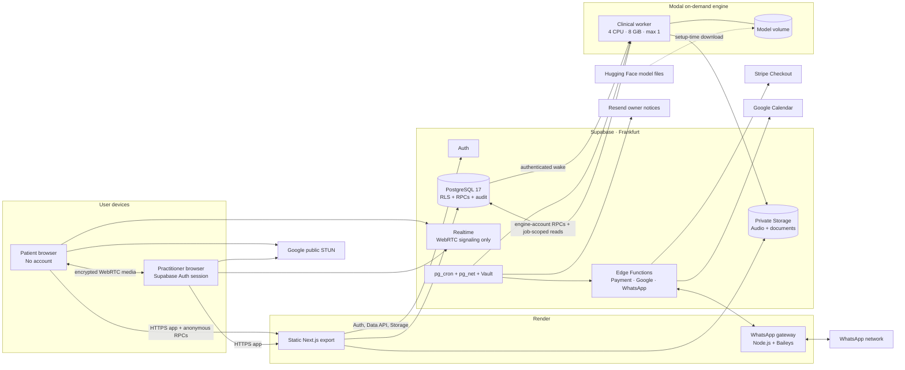
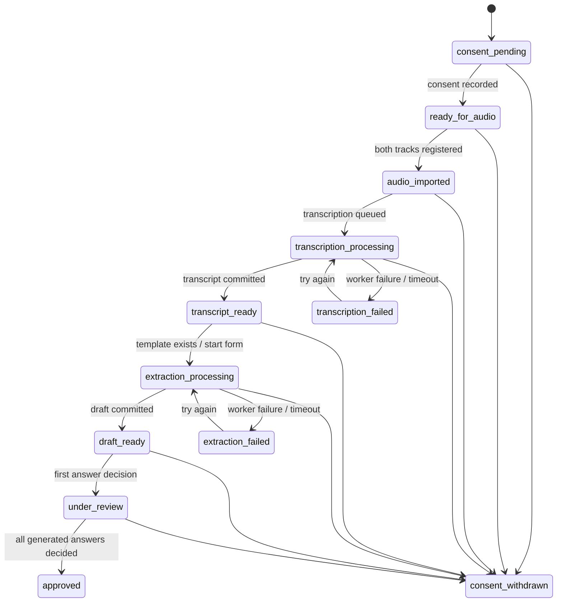

# Watson architecture and workflow

**Implementation baseline:** repository HEAD `bd9b54d`, reviewed 21 October 2026.  
**System status:** development proof of concept, invented data only; not approved for real patients.

This document describes what the repository currently implements. It does not describe a target architecture. The hosted topology is inferred from deployment scripts and decision records; live-provider configuration was not inspected.

## System context

### Runtime components

- **Static web app — `apps/web`:** Next.js static export on Render. It contains practitioner screens, public booking/join screens, browser WebRTC signaling, browser recording, Storage uploads, and Data API/RPC calls. It has no application server.
- **Supabase control plane — `supabase`:** Auth, PostgreSQL, Realtime, Storage, Edge Functions, Vault, `pg_cron`, and `pg_net`. PostgreSQL holds the workflow state machine and is the source of truth.
- **Clinical worker — `apps/clinical-worker`:** Python process that claims one job at a time. The current hosted path is an on-demand Modal deployment. The same worker can still run continuously on a controlled machine.
- **WhatsApp gateway — `apps/whatsapp-gateway`:** Node.js/Baileys linked-device sidecar on Render. It is the current route while a verified Meta business is unavailable. The official Meta Cloud API path remains implemented but is selected only when the gateway secret is absent.
- **External providers:** Stripe Checkout, Google Calendar OAuth/API, WhatsApp, Google public STUN, Hugging Face model downloads, and Resend owner alerts.

## Trust and data boundaries

### 1. Public patient boundary

Patients do not have accounts. An eight-character short code is resolved by `open_short_link` to a 64-character consultation invite token. That token is then the capability credential for the join page, payment initiation/confirmation, patient identity input, document upload/removal, and the Realtime signaling topic.

The patient browser receives only consultation time, fee/payment state, its submitted identity, its uploaded-document metadata, the WhatsApp link code, and the booking-page slug when relevant. It does not receive transcripts or forms.

### 2. Practitioner boundary

Practitioners sign in through Supabase Auth. RLS and security-definer RPCs bind reads and mutations to `auth.uid()`. The browser directly reads owned consultations, jobs, transcripts, forms, patient records, document metadata, and WhatsApp messages.

### 3. Service boundary

Edge Functions hold provider credentials and the Supabase service key. Browser requests to payment and Google functions are origin-checked; Google practitioner actions also verify the bearer JWT. Stripe webhooks verify Stripe signatures. Cron, Modal wake, and gateway requests use separate shared secrets.

### 4. Engine boundary

The worker signs in as a dedicated registered engine account. It does not use the service key and listens on no port. Database RPCs restrict it to claiming work, heartbeats, and atomic completion/failure calls. Storage policies permit audio or document reads only while that engine owns the corresponding processing lease.

### 5. Provider boundary

Card data stays on Stripe. Google refresh tokens are stored in a service-role-only table. WhatsApp content passes through either Meta or the Render gateway and WhatsApp network. Clinical media and generated clinical text are not intentionally sent to hosted inference APIs; inference runs inside the worker.

## Data stores and lifecycle

- **PostgreSQL:** practitioner profiles, patients, consultations, booking holds, Google connection metadata and refresh tokens, busy times, audio-track metadata, job leases, transcripts and segments, form templates/jobs/answers, document metadata and extracted page text, WhatsApp contacts/messages, append-style audit events, engine runs, gateway health, and encrypted gateway state.
- **Private `audio` bucket:** two per-consultation audio objects, one for the practitioner and one for the patient. The practitioner browser uploads them after the call. The worker downloads claimed tracks to a mode-`0600` temporary directory and removes that directory after processing.
- **Private `documents` bucket:** PDF, JPEG, PNG, or WebP files up to 10 MiB. A database record is created before upload and confirmed only when the stored byte count matches.
- **Modal model volume:** Whisper, RapidOCR, and Qwen GGUF/ONNX artifacts. It should contain models, not patient records. Model downloads happen through the explicit `fetch_models` deployment operation.
- **Browser memory:** live audio/video streams and two `MediaRecorder` buffers. Video is never persisted by Watson. The recording can be lost if the practitioner closes the page before upload finishes.
- **Audit log:** records state-changing security and workflow events with allow-listed metadata. It intentionally excludes transcript/document/form text.

No repository-enforced retention schedule archives or deletes completed consultations, audio, documents, transcripts, or forms. Consent withdrawal deletes transcript/track records and asks the practitioner browser to delete audio objects; document retention is separate in the current implementation.

## End-to-end workflow

```mermaid
flowchart LR
  A[Publish hours] --> B[Patient books]
  B --> C{Fee?}
  C -->|Yes| D[35-minute hold\nStripe Checkout]
  C -->|No| E[Confirmed booking]
  D -->|Paid| E
  D -->|Expired| X[Time released]
  E --> F[Optional documents\nWeb or WhatsApp]
  E --> G[Patient joins by token]
  G --> H[Browser-to-browser\nWebRTC call]
  H --> I[Doctor browser saves\ntwo audio tracks]
  I --> J[Transcription queued]
  F --> K[Document reading queued]
  J --> L[Modal wake + claim]
  K --> L
  L --> M[Whisper transcript]
  L --> N[PDF text / RapidOCR]
  M --> O[Form job auto-queued]
  N --> O
  O --> P[Qwen structured draft\nwith evidence]
  P --> Q[Practitioner accepts,\nedits, or rejects]
  Q --> R[Approved form]
```

### Booking, payment, and calendar

1. A practitioner saves a public profile, languages, weekly hours, appointment length, gap, fee, and time zone.
2. `booking_times` subtracts existing consultations and cached Google busy intervals. Slots start at least two hours in the future and are generated for at most 35 days.
3. `book_time` locks the practitioner profile, rechecks availability, creates the consultation and patient link, and identifies the patient from the submitted phone or email. A paid slot receives a 35-minute hold; a free slot does not expire.
4. For a fee, the payment Edge Function renews the hold and creates a Stripe Checkout Session. Watson never receives card details.
5. Payment is fulfilled idempotently either on browser return or by a signed Stripe webhook. The amount is compared with the consultation fee before `paid_at` is written.
6. Every five minutes, `pg_cron` calls the Google Edge Function. It refreshes OAuth access, reads only free/busy windows from the primary calendar, replaces cached busy intervals, and writes paid/free Watson bookings into a dedicated Google calendar.

### Patient link and WhatsApp

1. `/j/{code}` calls `open_short_link` and redirects to `/join/?t={invite-token}`.
2. The join page loads limited consultation details. If payment is outstanding, UI blocks the call and sends the patient to Stripe.
3. A patient can send `Watson {whatsapp-code}` to link their phone to one consultation. Subsequent PDFs/photos from that number become consultation documents.
4. With the current gateway path, only known linked numbers are forwarded and only text, photos, and PDFs are accepted. Pairing state is AES-GCM sealed in the gateway, then stored as ciphertext in PostgreSQL because Render storage is ephemeral.
5. The gateway polls the WhatsApp Edge Function every minute for due reminders. Database cron checks gateway health every five minutes. A 20-minute outage or lost pairing can trigger a deduplicated Resend notice to the owner.

### Call and recording

1. Practitioner and patient browsers join a Supabase Realtime broadcast channel named with the invite token.
2. SDP offers/answers and ICE candidates pass through Realtime. Audio and video pass directly between browsers through encrypted WebRTC.
3. Google public STUN helps peers discover routes. There is no TURN relay, so restrictive networks may fail to connect.
4. The practitioner browser records only audio: its microphone and the incoming patient audio as separate 32 kbit/s tracks on one browser clock. Patient video is not recorded.
5. At call end, both blobs are hashed, uploaded to private Storage, registered as tracks, declared co-recorded, and transcription is queued.

## Three ML processing lanes

### Transcription lane

1. A queued `transcription_job` wakes Modal through a Vault-held URL and bearer secret.
2. The worker claims the oldest job. Storage grants access to only the two tracks attached to that lease.
3. The worker validates format, maximum size, SHA-256, and duration; then runs `faster-whisper` `large-v3-turbo` on each speaker track.
4. Segments are merged by the shared clock. The database validates the whole transcript payload, supersedes the previous current transcript, and commits transcript, segments, track validation, job completion, and consultation state atomically.
5. A successful transcript automatically queues a form job if the practitioner has a template.

### Document OCR/parsing lane

1. Patient, practitioner, or WhatsApp code creates a document record, uploads the file, and confirms stored size.
2. The worker claims the oldest confirmed waiting document. It extracts native PDF text; pages below 20 characters are rendered at about 144 DPI and OCRed with RapidOCR PP-OCRv5 mobile Latin. Images are EXIF-rotated before OCR.
3. Processing is limited to 30 PDF pages and 20,000 characters per page. Extracted page text is stored in PostgreSQL. Empty output becomes `unreadable`.
4. Document work has a ten-minute stale-claim threshold but no heartbeat during OCR.

### Form-extraction lane

1. A form job receives the current template, non-speech transcript segments, and readable documents associated with the patient. Document context is newest-first and capped at 12,000 characters.
2. Qwen3.5-4B Q4_K_M runs through `llama.cpp`. JSON-schema constrained output requires every template field, transcript evidence line numbers, and optional document line numbers.
3. The worker drops unknown citations, converts “not specified” style text to null, caps answer length, and submits all answers atomically.
4. The practitioner reviews every non-empty answer as accepted, edited, or rejected. Approval is refused while any generated non-empty answer remains unreviewed.

## Job ordering, retries, and shutdown

The worker processes one item per loop in fixed priority: **transcription → document → form**. The Modal function allows one container, four CPU cores, 8 GiB memory, a one-hour timeout, and two platform retries.

- **Transcription:** heartbeats carry stage and measured duration. A lease is stale after two minutes. It is requeued up to attempt three; then it fails as `ENGINE_STALLED`. Runtime timeout is three times combined audio duration plus five minutes.
- **Documents:** no heartbeat. A claim stale for ten minutes returns to waiting; after three attempts it fails as `ENGINE_STALLED`.
- **Forms:** heartbeat every configured interval. A lease is stale after two minutes and is requeued up to attempt three. Hard timeout is one hour.
- **Late results:** every engine mutation names the attempt and owning engine. Results from cancelled, replaced, or stale attempts are refused.
- **On-demand drain:** the worker polls until its idle window expires. `engine_run_finished` takes the same advisory lock as wake-up and refuses shutdown if work appeared, preventing a queue/stop race.
- **Cost guard:** database accounting limits on-demand engine runs to three hours per month. Modal workspace budget and account credit form additional caps. When the database allowance is exhausted, work stays queued and the owner receives one notice for that month.

## Consultation state path

The schema also contains `transcript_under_review`, `transcript_reviewed`, `corrected`, and `archived`. The current primary UI renders transcript text and performs review on form answers; no current page implements a full transcript-correction workflow.

## Current security posture and known boundary failures

Existing controls include RLS on application tables, explicit function grants, private buckets, job-scoped engine reads, signed Stripe webhooks, separate cron/gateway/wake secrets, amount-checked idempotent payment recording, bounded upload types/sizes, atomic result commits, and an audit trail without clinical text.

The implementation remains unsuitable for real patient data. The six open findings in [`security-review-2026-10-18.md`](security-review-2026-10-18.md) directly affect these boundaries:

1. Orphaned document objects can become anonymously readable.
2. Unverified phone/email input can attach a consultation to an existing patient.
3. Realtime signaling trusts client-selected roles and does not enforce payment or revocation.
4. Anonymous booking quotas can be bypassed by rotating contact values.
5. Google OAuth state is signed but not browser-bound or one-time.
6. Consent withdrawal does not cancel document processing or reject document results.

Other current constraints: invite/short/WhatsApp codes have no explicit expiry; no TURN relay exists; the WhatsApp gateway uses a linked personal number and an unofficial Baileys integration; document parsing is not process-isolated; model files are not commit/hash pinned; and no live deployment or vendor-compliance assertion is established by this document.

## Source map

- WebRTC and recording: `apps/web/src/lib/call.ts`, `apps/web/src/app/room/page.tsx`, `apps/web/src/app/join/page.tsx`
- Audio upload: `apps/web/src/lib/tracks.ts`
- Booking/payment/calendar: `supabase/migrations/20261016100000_booking.sql`, `supabase/functions/payment`, `supabase/functions/stripe-webhook`, `supabase/functions/google`
- Documents/WhatsApp: `supabase/migrations/20261014150000_documents.sql`, `supabase/migrations/20261014160000_whatsapp.sql`, `supabase/functions/whatsapp`, `apps/whatsapp-gateway`
- Transcription/forms: `supabase/migrations/20261013220000_transcription.sql`, `supabase/migrations/20261014120000_forms.sql`, `apps/clinical-worker/src/clinical_worker`
- Modal wake/drain: `supabase/migrations/20261016150000_cloud_engine.sql`, `apps/clinical-worker/modal_engine.py`
- Deployment: `scripts/deploy-web.sh`, `scripts/deploy-whatsapp-gateway.sh`, `scripts/configure-cloud-engine.sh`, `scripts/configure-schedule.sh`
